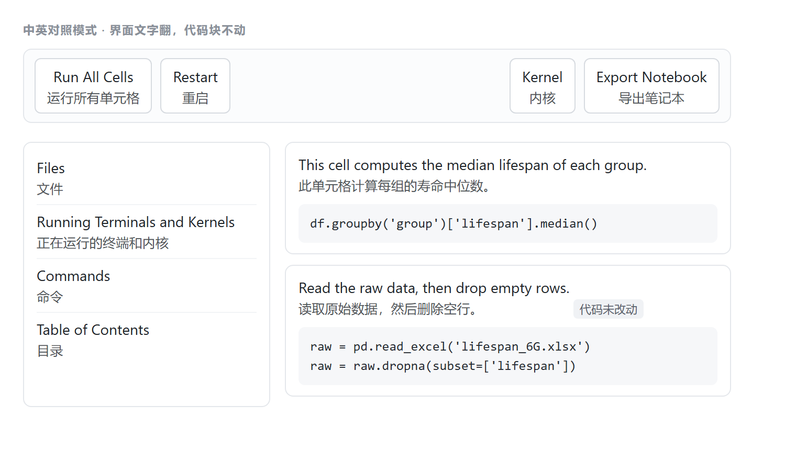
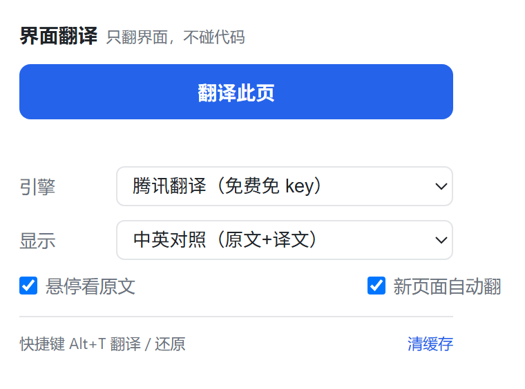

# 界面翻译 · UI Translator

一个 Chrome 扩展：**只翻界面文字，自动跳过代码块。**

Chrome 自带翻译是「整页送去翻」——代码、缩进、变量名一起被翻乱，按钮变宽、工具栏跟着塌。这个扩展反过来做：先判断哪些是界面文本，只送那部分。`<code>` / `<pre>` / `<kbd>` / 代码编辑器 / 已是中文的内容一律不动。

<p align="center">
  
</p>

<p align="center">
  
</p>

## 特点

- **不碰代码**：`<code>` `<pre>` `<kbd>` `samp`、CodeMirror / Monaco / Ace 编辑器、`contenteditable`、`svg`、`math` 全部跳过；纯数字、纯符号、已是中文的也不送。
- **连属性一起翻**：`title`、`placeholder`、`aria-label`、`alt`。工具栏上那些只有图标的按钮，靠这一步才翻得出来。
- **中英对照**：原文一行、译文一行，译文略小略淡。原文和译文包在同一个容器里，所以在 flex / grid 布局里只占一个位置，不会把译文甩到旁边。
- **点一次，之后自动翻**：翻过一页后，新开的英文页面自己翻，不用再点。再按一次 `Alt+T` 就停。
- **悬停看原文**：鼠标停在译文上弹出原文，方便核对有没有翻错。
- **免费、免 key**：默认走腾讯交互翻译的公开接口；想更好可以换成任意 OpenAI 兼容大模型（DeepSeek / 通义 / Kimi / 本地 ollama）。
- **快**：并发调度 + 分批实时写回，300 处界面文字约 3.5 秒，第一批译文约 0.4 秒就出现。

## 安装

1. 下载本仓库（`Code` → `Download ZIP`，或 `git clone`）
2. Chrome 地址栏输入 `chrome://extensions/`
3. 右上角打开 **开发者模式**
4. 左上角 **加载已解压的扩展程序**，选择仓库里的 **`extension`** 这一层（不是上一层）
5. 建议点工具栏的拼图图标，把「界面翻译」钉到工具栏上

没有图标文件是正常的，Chrome 会给一个灰色默认图标，不影响功能。

## 使用

打开任意英文网页 → 点工具栏图标 → 点 **翻译此页**。

| 动作 | 结果 |
|---|---|
| 点「翻译此页」/ `Alt+T` | 翻当前页，**同时打开自动模式** |
| 之后打开或切换网页 | 自动翻译，不用再点 |
| 再按 `Alt+T`（或点「还原原文」） | 还原当前页，**同时关掉自动模式** |
| 弹窗里取消勾选「新页面自动翻」 | 只关自动模式，当前页保持已翻状态 |

弹窗里三个选项：

| 选项 | 说明 |
|---|---|
| 引擎 | 腾讯翻译（免费）/ 大模型（填接口、模型名、API Key，只存本机） |
| 显示 | **中英对照（默认）** / 直接替换 |
| 新页面自动翻 | 新页面自动翻译，页内动态加载的新内容也会补翻 |

自动模式会自动跳过：中文 / 日文 / 韩文页面（看 `lang`，没有就采样判定）、后台标签页（等切到前台才翻）、没东西可翻的页面（静默）。

## 实现要点

**只翻该翻的。** 从 `body` 遍历文本节点，逐条判断：父元素是否命中跳过选择器、是否可见（`display` / `visibility` / `opacity`）、文本是否有翻译价值。可见性与跳过判断按元素缓存，同一父元素下的多个文本节点只算一次。

**去重。** 同一段文字（比如列表里重复出现的 `Save`）只发一次请求，结果回填到所有出现的位置。

**并发 + 实时写回。** 拆成批次后开 6 条流水线同时发（大模型引擎 3 条），谁空了谁领下一批。每批回来立刻写进 DOM，不必等全量——所以第一批译文约 0.4 秒就出现，而不是先干等几秒。回报是串行，写回按元素对位，测试里专门验了 300 个元素零错配。

**重试而不是降级。** 接口排队时会返回 `ret_code: "busy"`。旧做法是整批退回单条接口逐条翻，60 条要 36 秒；现在改成退避重试（300 / 600 ms），真有硬故障才拆半再试。

## 速度（实测，300 条全新界面文本）

| 方案 | 总耗时 |
|---|---|
| 串行，每批 25 条 | ≈14 s |
| 并发 2，每批 60 条 | 8.3 s |
| **并发 6，每批 40 条（现用）** | **3.5 s** |
| 并发 10 | 3.1 s |

批大小几乎不影响单条成本（每条约 45 ms），所以堆大批次没用，并发才是杠杆。取 6 是因为再往上收益递减、被限流的风险变大。

## 测试

功能测试在 jsdom 里真跑 `content.js` / `background.js`，走真实网络接口。

```bash
cd tests
npm i jsdom --registry=https://registry.npmmirror.com

node test-0-api-and-headers.mjs        # 接口连通性与请求头
node test-1-skip-code-and-restore.mjs  # 跳过代码 / 属性 / 还原
node test-2-dedup-and-bilingual.mjs    # 去重、长句拆段
node test-3-popup-reinject.mjs         # 弹窗自动补注入
node test-4-bilingual-structure.mjs    # 对照结构与 flex 占位
node test-5-concurrency-alignment.mjs  # 并发对位（300 元素零错配）
node test-6-background-retry-cache.mjs # 重试 / 兜底 / 缓存
node test-7-auto-translate.mjs         # 自动模式
node test-8-untranslated-not-cached.mjs # 未翻译结果不污染缓存
```

当前结果：15/15、5/5、7/7、13/13、11/11、11/11、28/28、13/13。`tests/bench-*.mjs` 是 4 个联网基准，用来验证上面那张速度表，跑一次 1~2 分钟。

## 已知限制

- **带「字母 + 数字」token 的短句会被原样返回**（如 `net16`、`Layer 3`）。这是免费引擎的确定性行为：单条重试 3 次、整批重发 3 轮，结果一字不差。真实界面短语（`Run All Cells`、`Kernel`、`Save As`）不受影响。漏翻率约 1%。

  这类「没翻出来」的结果**不会进缓存**（v1.2.1 起）：下次打开同一页会重新请求，而不是把英文当成译文永久显示。
- **`chrome://` 页面、应用商店页、PDF 阅读器**不允许扩展注入，属浏览器限制。
- **对照模式每处文字占两行**，这是对照的固有代价；密集工具栏觉得挤就切「直接替换」。
- 免费接口不保证长期可用。挂了就在弹窗里切大模型引擎，或改 `extension/background.js` 里的接口地址。

## 许可

[MIT](LICENSE)

详细安装说明、逐项自检记录与排错表见 [docs/安装说明.md](docs/安装说明.md)。
